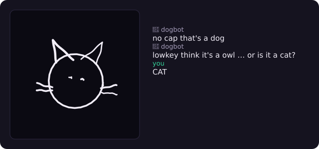

# iguess

A multiplayer drawing-and-guessing game in the skribbl.io vein, with one twist:
an AI vision model plays as one of the guessers. It looks at the live canvas and
types answers into chat along with everyone else. (It guesses "dog" a lot.)

**Live:** [iguess.aidenjang.com](https://iguess.aidenjang.com)

`TypeScript` · `Cloudflare Workers` · `Durable Objects` · `raw WebSockets` · `React` · `Vite` · `Canvas`

The game itself is straightforward; I built it mostly to work on the structure.
The game engine has no idea AI exists. Everything AI-related lives in game
*modes*, which plug into the engine, so "AI guesser", "AI drawer", "humans vs
AI", and "you vs AI" are separate modes rather than changes to the core.

> Part of a [platform of apps](https://github.com/aiden-jang/platform/blob/main/PLATFORM.md) that share one sign-in. For the design decisions and
> how I'd scale it, see **[ARCHITECTURE.md](./ARCHITECTURE.md)**.

---

## Screenshots

The AI drawing, and being wrong about it, in real time:



The drawer sees the word and sketches it; the AI is in chat guessing off the
canvas. Here, "GUITAR":


The same canvas in a guesser's window. They only see masked letters, not the
word. Proof the strokes sync live and the word stays secret:


| Join screen | Word choice |
|---|---|
|  |  |

<!--
  Screenshots captured by driving two browser sessions through a real game with
  Playwright; the script lives outside the repo. To refresh them, run the app
  (see "Running locally"), play a round, and replace the PNGs in docs/.
  A short GIF of the live sync would be even better if you record one.
-->

---

## What's in it

- The server is authoritative. The drawer paints locally so their own strokes
  feel instant, but the server holds the real state, saves every stroke, and
  relays them to everyone else. Clients can't fake game state.
- The secret word is only ever sent to the drawer (`your_word`). The AI worker
  gets the pixels and the same masked hint every human guesser can see
  (`_ u _ t a _`), never the answer — so it plays fair rather than blind, and
  there is still nothing to cheat with.
- The engine and the modes are separate. `engine.ts` runs the turn timeline and
  scoring and doesn't know any game rules. A `GameMode` decides who draws, what
  the word is, and how chat is read. `AIGuesserMode` is about 70 lines and
  doesn't touch the engine.
- Full game loop: multiple rounds with a rotating drawer, a word-choice step
  (one word per difficulty tier, with a once-per-game skip), letter hints that
  reveal as the timer runs down, and guess matching that ignores case, accents,
  and punctuation (plus a private "so close!" when you're one letter off).
- Scoring is a set of incentives rather than a single number: speed, then the
  word's difficulty, then a bonus for reading the drawing before any letter
  appears, then a capped bonus for whoever is behind. The drawer is paid by how
  fast people read their drawing, not a flat rate per guesser.
- 381 words in three tiers, themed packs, and a room can type in its own. Each
  room remembers what it has already served, so an evening of short games stops
  recycling the same handful.
- The AI's drawings are 40 hand-coded vector doodles, redrawn every time by an
  unsteady hand: densified lines, sideways waver, a global tilt, corner
  overshoot. The same word never draws the same picture twice, and it appears
  point by point rather than a stroke at a time.
- Rooms have a host, a ready check, and a spectator gallery: the ninth player
  watches instead of being turned away.
- The AI joins the roster as a regular player, so it goes through the same
  presence, scoring, and turn-end code as a human. The engine has no AI branch.
- Vision runs in a separate `ai-worker` Worker that turns the stroke log into a
  PNG and calls a model. A slow or failed call won't block the WebSocket loop; it
  just means no guess that round.
- Vision providers (mock / OpenAI / Anthropic) sit behind one interface and are
  picked based on env vars. With no API key it uses the mock and still runs.
- The bot returns a ranked shortlist, not one word, so its runners-up become the
  joke ("no cap that's a dog … or is it a horse"). It paces its own guessing by
  how much new ink has appeared, which also stops it spending vision calls on a
  canvas nobody is touching.
- Rules that both sides need — undo, word tiers, the end-of-game awards — live in
  `shared/` as pure functions, so the client and the server can't disagree about
  them. Each is unit-tested without a socket or a Durable Object.

A note on comments: they're for traps and constraints, not for describing the
code. If a comment is there, it's recording something that would cost someone
real time to find out the hard way — usually a thing that already bit once.

---

## Architecture

```
            Browser (React + Canvas)
        ┌──────────────────────────────┐
        │  DrawingCanvas   Chat/Score   │
        │      │  ▲            │  ▲      │
        │  draw│  │remote   chat│  │state│
        └──────┼──┼────────────┼──┼─────┘
               │  │            │  │
               ▼  │            ▼  │        WebSocket (wss, raw)
        ╔══════════════════════════════════════╗
        ║   game-server Worker                   ║
        ║                                        ║
        ║   worker.ts  (routing, SPA assets)     ║
        ║       │  /rooms/:id/ws → Durable Object ║
        ║       ▼                                ║
        ║   GameRoom (Durable Object, 1/room)    ║
        ║       │   in-memory roster + stroke log ║  (single-threaded per room;
        ║       ▼   pinned WebSockets for timers   ║   no external store needed)
        ║   engine.ts ── turn timeline, scoring ─ ║
        ║       ▼                                ║
        ║   GameMode (strategy)                  ║
        ║   ├─ ClassicMode   (humans only)       ║
        ║   ├─ AIGuesserMode (adds virtual AI)   ║
        ║   ├─ AIDrawerMode  (AI draws)          ║
        ║   ├─ TeamBattleMode(humans vs AI)      ║
        ║   └─ DuelMode      (you vs AI)         ║
        ║              │                         ║
        ╚══════════════┼════════════════════════ ╝
                       │ HTTP POST /guess { ops }
                       ▼
        ┌───────────────────────────────────────┐
        │            ai-worker (Worker)          │
        │   strokeRender: ops → PNG (resvg-wasm) │
        │   VisionProvider: Mock|OpenAI|Anthropic│
        └───────────────────────────────────────┘
```

A few of the choices and why:

| Decision | Choice | Why |
|---|---|---|
| State authority | Authoritative server | One source of truth, and clients can't cheat. The drawer renders locally to hide latency. |
| Room runtime | One Durable Object per room | A room is single-threaded per its id, so roster + stroke log live in the object's memory: no external store, no lock, no cross-instance race. An idle room costs nothing. |
| Dropped Redis | In-memory in the DO | The old Node build used Redis for presence + strokes across instances. A Durable Object *is* the single instance for a room, so that entire dependency (and its ops cost) went away in the port. |
| WebSocket style | Pinned (`server.accept()`), not hibernation | The turn timeline runs on `setTimeout`/`setInterval`; hibernation evicts timers, so a room stays pinned while a game is live. |
| Transport | Raw `ws`, not Socket.IO | I wanted to see the actual protocol instead of relying on hidden reconnection/room behavior. |
| Player identity | Client-asserted `pid` in `sessionStorage` | A reconnect has to be the *same* player or you lose your score, your place in the draw order and your turn. The server gives a returning `pid` an 8-second grace window and rejoins it silently. Keeping that id in `sessionStorage` rather than a variable is what makes it survive a refresh — the most common reconnect there is — while staying per-tab, so two tabs on one device are still two players. |
| Stroke format | Normalized 0–1 coords, streamed ops | Works at any canvas size, messages stay small, and the op log replays for late joiners and the AI. |
| AI guess timing | Interval (~8s first, then every 10s, max 4/turn) | Keeps cost and latency bounded without spamming the model. |
| AI process | Separate Worker | Vision calls are slow, so I kept them off the WebSocket loop. |
| AI identity | Virtual player in roster | Lets it reuse the human scoring/turn code instead of adding AI special cases. |

---

## Project layout

```
shared/events.ts                 the typed client↔server contract
packages/game-server/            game Worker: routing + Durable Object + engine + modes
  src/worker.ts                  fetch handler: routes /rooms/:id/ws → DO, serves the SPA
  src/GameRoom.ts                Durable Object: one per room, holds roster + stroke log
  src/engine.ts                  mode-agnostic turn timeline & scoring
  src/modes/GameMode.ts          EngineContext + GameMode interface
  src/modes/ClassicMode.ts       base mode (humans take turns)
  src/modes/AIGuesserMode.ts     extends ClassicMode, adds AI guesser
  src/modes/AIDrawerMode.ts      AI is the sole drawer
  src/modes/TeamBattleMode.ts    Humans vs AI, round-win race
  src/modes/DuelMode.ts          You vs AI, alternating drawer, cumulative points
  src/ai/{aiGuessLoop,aiDrawLoop}.ts  composable AI cadence helpers
  src/text.ts                    guess normalization + close-match
  src/services/aiWorkerClient.ts resilient HTTP client to ai-worker
  src/doodles.ts                 40 hand-coded vector doodles the AI draws
  src/humanize.ts                redraws a doodle with an unsteady hand
  src/ai/persona.ts              the bot's name and commentary
  src/wordMemory.ts              per-room recency, so games stop repeating
  src/hosting.ts                 who holds the room, who is watching
  src/limits.ts                  player/spectator caps, close codes
  src/inviteMeta.ts              per-room link-preview rewriting
packages/ai-worker/              vision Worker
  src/worker.ts                  fetch handler: POST /guess, /health
  src/strokeSvg.ts               DrawOps → SVG (pure)
  src/strokeRender.ts            SVG → PNG via @resvg/resvg-wasm
  src/visionProviders.ts         Mock | OpenAI | Anthropic
  src/ogCard.ts                  per-room link-preview PNG
packages/client/                 React + Vite + Canvas UI
  src/paint.ts                   canvas painter (live board + replay share it)
  src/Replay.tsx                 redraws a finished round
  src/styles.ts                  inline style objects
shared/                          the protocol, and the game data both sides need
  events.ts                      every message crossing the socket
  words.{ts,json}                381 words in three difficulty tiers
  packs.json                     themed subsets of that list
  awards.ts                      end-of-game awards (pure, so it is testable)
  strokeLog.ts                   undo, shared so both sides agree
e2e/                             Playwright, against the real Worker + DO
```

---

## Running locally

Requires **Node 22** (repo `.nvmrc`) and pnpm. No Redis, no Docker. The game
server, the Durable Object, and the AI worker all run under `wrangler dev`
(Miniflare), and the client runs under Vite.

```bash
pnpm install

# terminal 1: game-server on :33300 + GameRoom Durable Object. For AI modes, point it at the
# local ai-worker (terminal 2); classic mode works without this override.
pnpm --filter @iguess/game-server dev -- --var AI_WORKER_URL:http://localhost:33400

# terminal 2: ai-worker (vision) on :33400
pnpm --filter @iguess/ai-worker dev

# terminal 3: client (http://localhost:33100, proxies /rooms to the game server)
pnpm --filter @iguess/client dev
```

Open two browser tabs, join the same room, and pick the **AI** mode from the
join screen (or append `?mode=ai`) to play against the vision model. With no API
key configured the mock provider makes random guesses so everything still works,
and the room is told the AI can't see the canvas; set `OPENAI_API_KEY` or
`ANTHROPIC_API_KEY` as a `wrangler secret` on the ai-worker for a real model. See [DEPLOY.md](DEPLOY.md) for production.

### Quick demo

The thing worth showing is live sync plus the AI guessing on one screen. Open two
browser windows side by side.

1. Window A: join room `demo` as `Alice`, mode "AI guesser (🤖 competes)".
2. Window B: join room `demo` as `Bob`, then click Start game.
3. Whoever's drawing, start drawing. The strokes show up in the other window
   right away.
4. After ~8s the AI starts guessing in the same chat as the human. Land a guess
   and the scoreboard updates.

For the other modes, start a fresh room as "AI drawer" (the AI draws, you guess),
"Team battle" (humans vs AI), or "You vs AI" (trade turns with the machine).
Same engine, different mode.

### Tests

```bash
pnpm -r test                              # 158 unit tests: 131 game-server, 27 ai-worker
pnpm --filter @iguess/game-server test    # engine + modes + helpers
pnpm --filter @iguess/ai-worker test      # stroke→SVG + vision providers
pnpm test:e2e                             # 9 Playwright specs, real Worker + DO
```

The engine tests run whole games through the `GameEngine` with in-memory deps
(no sockets or real timers), covering rounds, scoring, hints, the word-choice
step, and guess matching.

The e2e suite starts the SPA and the game-server Durable Object for real. It
deliberately starts the game-server **without** `AI_WORKER_URL`, so a test run
can never reach a paid vision provider — `.dev.vars` outranks `--var`, so there
is no way to force the mock from the command line. The AI guess path is covered
by unit tests instead.

---

## Deploying

CI deploys on merge to `main` (`.github/workflows/ci.yml`), after typecheck, lint,
build, unit tests and the e2e suite all pass. That is the normal path.

To ship by hand:

```bash
pnpm run deploy        # checks first, then both Workers
pnpm run deploy:only   # skip the checks (know why you're doing this)
```

Two things to know:

- **`pnpm run deploy`, not `pnpm deploy`.** `deploy` is a built-in pnpm command
  (it copies a workspace package to a directory), so without `run` you get that
  instead of this script.
- **Order is not arbitrary.** The ai-worker goes first, then the game-server,
  which builds the client and serves it. Reverse them and you publish a
  game-server pointing at an ai-worker that hasn't shipped yet.

A manual deploy needs Cloudflare credentials, which CI gets from a repo secret.
Locally, run `wrangler login` once (or export `CLOUDFLARE_API_TOKEN`), or wrangler
will stop and ask.

---

## Observability

- **Errors + requests:** Workers Logs is enabled (`[observability]` in both workers'
  `wrangler.toml`), so uncaught throws are captured for the game-server and the ai-worker. Tail live
  with `pnpm --filter @iguess/game-server exec wrangler tail` (or `@iguess/ai-worker`).
- **Uptime:** each worker exposes `GET /health`, ready for a free external monitor (e.g.
  UptimeRobot).
