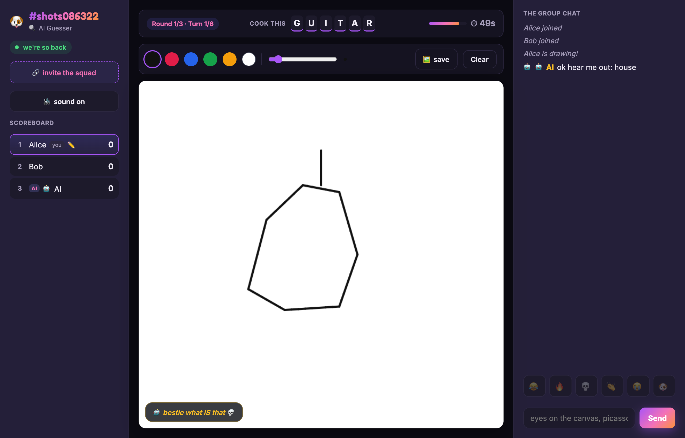
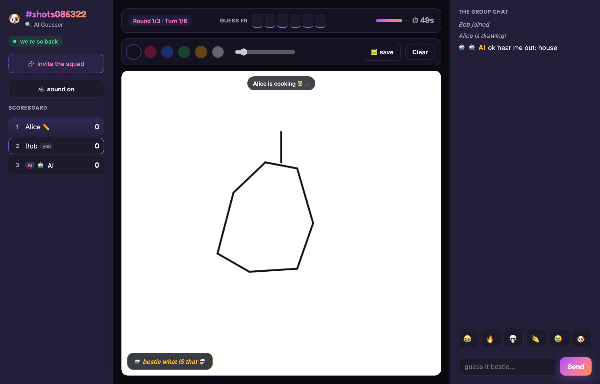
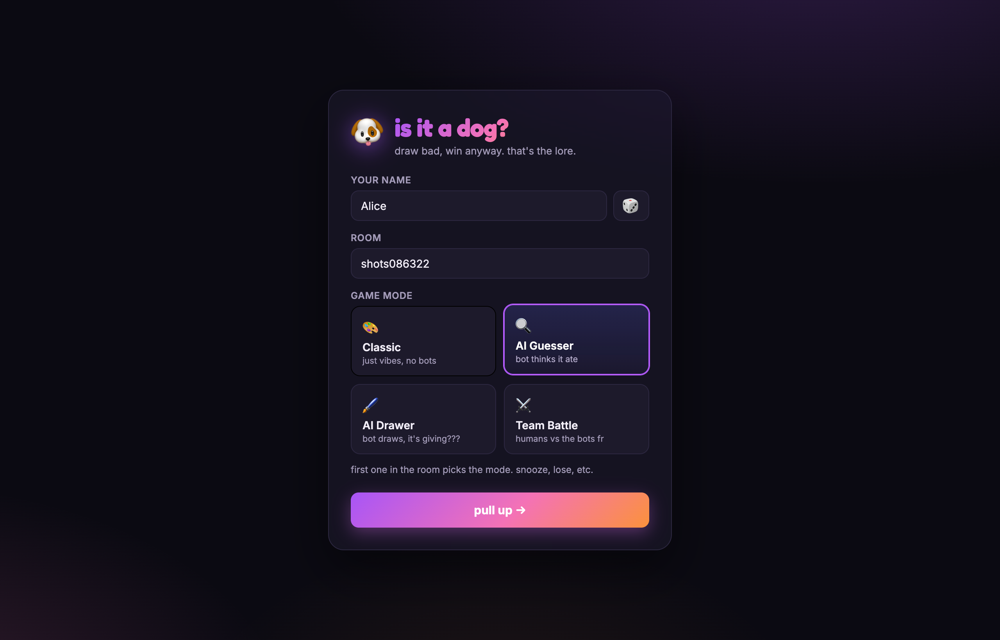
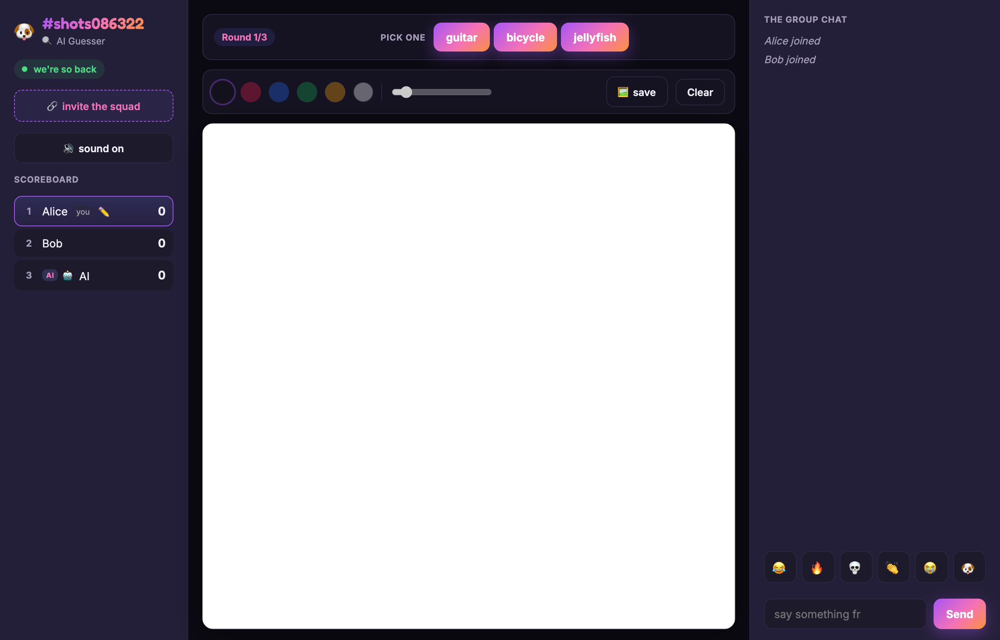

# iguess

A multiplayer drawing-and-guessing game in the skribbl.io vein, with one twist:
an AI vision model plays as one of the guessers. It looks at the live canvas and
types answers into chat along with everyone else. (It guesses "dog" a lot.)

**Live:** [iguess.aidenjang.com](https://iguess.aidenjang.com)

`TypeScript` · `Cloudflare Workers` · `Durable Objects` · `raw WebSockets` · `React` · `Vite` · `Canvas`

The game itself is straightforward; I built it mostly to work on the structure.
The game engine has no idea AI exists. Everything AI-related lives in game
*modes*, which plug into the engine, so "AI guesser", "AI drawer", and "humans vs
AI" are separate modes rather than changes to the core.

> Part of a [platform of apps](https://github.com/aiden-jang/platform/blob/main/PLATFORM.md) that share one sign-in. For the design decisions and
> how I'd scale it, see **[ARCHITECTURE.md](./ARCHITECTURE.md)**.

---

## Screenshots

The drawer sees the word and sketches it; the AI is in chat guessing off the
canvas. Here, "GUITAR":



The same canvas in a guesser's window. They only see masked letters, not the
word. Proof the strokes sync live and the word stays secret:



| Join screen | Word choice |
|---|---|
|  |  |

<!--
  Screenshots captured by driving two browser sessions through a real game with
  Playwright; the script lives outside the repo. To refresh them, run the app
  (see "Running locally"), play a round, and replace the PNGs in docs/.
  A short GIF of the live sync would be even better if you record one.
-->

---

## What's in it

- The server is authoritative. The drawer paints locally so their own strokes
  feel instant, but the server holds the real state, saves every stroke, and
  relays them to everyone else. Clients can't fake game state.
- The secret word is only ever sent to the drawer (`your_word`), and never to the
  AI worker. So there's nothing to cheat with: the word just isn't in the data a
  client or the AI receives.
- The engine and the modes are separate. `engine.ts` runs the turn timeline and
  scoring and doesn't know any game rules. A `GameMode` decides who draws, what
  the word is, and how chat is read. `AIGuesserMode` is about 70 lines and
  doesn't touch the engine.
- Full game loop: multiple rounds with a rotating drawer, a word-choice step
  (pick one of three), letter hints that reveal as the timer runs down, scoring
  that rewards guessing fast, and guess matching that ignores case, accents, and
  punctuation (plus a private "so close!" when you're one letter off).
- The AI joins the roster as a regular player, so it goes through the same
  presence, scoring, and turn-end code as a human. The engine has no AI branch.
- Vision runs in a separate `ai-worker` Worker that turns the stroke log into a
  PNG and calls a model. A slow or failed call won't block the WebSocket loop; it
  just means no guess that round.
- Vision providers (mock / OpenAI / Anthropic) sit behind one interface and are
  picked based on env vars. With no API key it uses the mock and still runs.

---

## Architecture

```
            Browser (React + Canvas)
        ┌──────────────────────────────┐
        │  DrawingCanvas   Chat/Score   │
        │      │  ▲            │  ▲      │
        │  draw│  │remote   chat│  │state│
        └──────┼──┼────────────┼──┼─────┘
               │  │            │  │
               ▼  │            ▼  │        WebSocket (wss, raw)
        ╔══════════════════════════════════════╗
        ║   game-server Worker                   ║
        ║                                        ║
        ║   worker.ts  (routing, SPA assets)     ║
        ║       │  /rooms/:id/ws → Durable Object ║
        ║       ▼                                ║
        ║   GameRoom (Durable Object, 1/room)    ║
        ║       │   in-memory roster + stroke log ║  (single-threaded per room;
        ║       ▼   pinned WebSockets for timers   ║   no external store needed)
        ║   engine.ts ── turn timeline, scoring ─ ║
        ║       ▼                                ║
        ║   GameMode (strategy)                  ║
        ║   ├─ ClassicMode   (humans only)       ║
        ║   ├─ AIGuesserMode (adds virtual AI)   ║
        ║   ├─ AIDrawerMode  (AI draws)          ║
        ║   └─ TeamBattleMode(humans vs AI)      ║
        ║              │                         ║
        ╚══════════════┼════════════════════════ ╝
                       │ HTTP POST /guess { ops }
                       ▼
        ┌───────────────────────────────────────┐
        │            ai-worker (Worker)          │
        │   strokeRender: ops → PNG (resvg-wasm) │
        │   VisionProvider: Mock|OpenAI|Anthropic│
        └───────────────────────────────────────┘
```

A few of the choices and why:

| Decision | Choice | Why |
|---|---|---|
| State authority | Authoritative server | One source of truth, and clients can't cheat. The drawer renders locally to hide latency. |
| Room runtime | One Durable Object per room | A room is single-threaded per its id, so roster + stroke log live in the object's memory: no external store, no lock, no cross-instance race. An idle room costs nothing. |
| Dropped Redis | In-memory in the DO | The old Node build used Redis for presence + strokes across instances. A Durable Object *is* the single instance for a room, so that entire dependency (and its ops cost) went away in the port. |
| WebSocket style | Pinned (`server.accept()`), not hibernation | The turn timeline runs on `setTimeout`/`setInterval`; hibernation evicts timers, so a room stays pinned while a game is live. |
| Transport | Raw `ws`, not Socket.IO | I wanted to see the actual protocol instead of relying on hidden reconnection/room behavior. |
| Stroke format | Normalized 0–1 coords, streamed ops | Works at any canvas size, messages stay small, and the op log replays for late joiners and the AI. |
| AI guess timing | Interval (~8s first, then every 10s, max 4/turn) | Keeps cost and latency bounded without spamming the model. |
| AI process | Separate Worker | Vision calls are slow, so I kept them off the WebSocket loop. |
| AI identity | Virtual player in roster | Lets it reuse the human scoring/turn code instead of adding AI special cases. |

---

## Project layout

```
shared/events.ts                 the typed client↔server contract
packages/game-server/            game Worker: routing + Durable Object + engine + modes
  src/worker.ts                  fetch handler: routes /rooms/:id/ws → DO, serves the SPA
  src/GameRoom.ts                Durable Object: one per room, holds roster + stroke log
  src/engine.ts                  mode-agnostic turn timeline & scoring
  src/modes/GameMode.ts          EngineContext + GameMode interface
  src/modes/ClassicMode.ts       base mode (humans take turns)
  src/modes/AIGuesserMode.ts     extends ClassicMode, adds AI guesser
  src/modes/AIDrawerMode.ts      AI is the sole drawer
  src/modes/TeamBattleMode.ts    Humans vs AI, round-win race
  src/ai/{aiGuessLoop,aiDrawLoop}.ts  composable AI cadence helpers
  src/text.ts                    guess normalization + close-match
  src/services/aiWorkerClient.ts resilient HTTP client to ai-worker
  src/words.{ts,json}            configurable word list
packages/ai-worker/              vision Worker
  src/worker.ts                  fetch handler: POST /guess, /health
  src/strokeSvg.ts               DrawOps → SVG (pure)
  src/strokeRender.ts            SVG → PNG via @resvg/resvg-wasm
  src/visionProviders.ts         Mock | OpenAI | Anthropic
packages/client/                 React + Vite + Canvas UI
```

---

## Running locally

Requires **Node 22** (repo `.nvmrc`) and pnpm. No Redis, no Docker. The game
server, the Durable Object, and the AI worker all run under `wrangler dev`
(Miniflare), and the client runs under Vite.

```bash
pnpm install

# terminal 1: game-server on :33300 + GameRoom Durable Object. For AI modes, point it at the
# local ai-worker (terminal 2); classic mode works without this override.
pnpm --filter @iguess/game-server dev -- --var AI_WORKER_URL:http://localhost:33400

# terminal 2: ai-worker (vision) on :33400
pnpm --filter @iguess/ai-worker dev

# terminal 3: client (http://localhost:33100, proxies /rooms to the game server)
pnpm --filter @iguess/client dev
```

Open two browser tabs, join the same room, and pick the **AI** mode from the
join screen (or append `?mode=ai`) to play against the vision model. With no API
key configured the mock provider makes random guesses so everything still works;
set `OPENAI_API_KEY` or `ANTHROPIC_API_KEY` as a `wrangler secret` on the
ai-worker for a real model. See [DEPLOY.md](DEPLOY.md) for production.

### Quick demo

The thing worth showing is live sync plus the AI guessing on one screen. Open two
browser windows side by side.

1. Window A: join room `demo` as `Alice`, mode "AI guesser (🤖 competes)".
2. Window B: join room `demo` as `Bob`, then click Start game.
3. Whoever's drawing, start drawing. The strokes show up in the other window
   right away.
4. After ~8s the AI starts guessing in the same chat as the human. Land a guess
   and the scoreboard updates.

For the other modes, start a fresh room as "AI drawer" (the AI draws, you guess)
or "Team battle" (humans vs AI). Same engine, different mode.

### Tests

```bash
pnpm --filter @iguess/game-server test    # engine + modes + helpers
pnpm --filter @iguess/ai-worker test      # stroke→SVG + vision providers
```

The engine tests run whole games through the `GameEngine` with in-memory deps
(no sockets or real timers), covering rounds, scoring, hints, the word-choice
step, and guess matching.

---

## Game modes

A mode implements the `GameMode` interface and gets an `EngineContext` of verbs
(`broadcast`, `awardPoints`, `endTurn`, `addParticipant`, and so on). The engine
calls the mode at set points (`configure`, `pickDrawer`, `pickWord`,
`pickWordChoices`, `onTurnStart`, `onChat`, `canDraw`, `onTurnEnd`, `onGameEnd`).
Adding a mode means writing a class, not editing the engine.

- **ClassicMode.** Humans take turns drawing, everyone else guesses in chat.
  The other three build on this one.
- **AIGuesserMode.** Adds an AI player that guesses off the live canvas on a
  timer.
- **AIDrawerMode.** The AI does all the drawing (its strokes go through the
  engine via `ctx.draw`) and humans guess.
- **TeamBattleMode.** Humans vs AI. Rounds alternate who draws, and the first
  correct guess wins the round for that side.

The `pickWordChoices` hook drives the word-choice step: return 2+ words and the
drawer gets to choose one; return `null` to skip it (the AI drawer just picks its
own word).

## Observability

- **Errors + requests:** Workers Logs is enabled (`[observability]` in both workers'
  `wrangler.toml`), so uncaught throws are captured for the game-server and the ai-worker. Tail live
  with `pnpm --filter @iguess/game-server exec wrangler tail` (or `@iguess/ai-worker`).
- **Uptime:** each worker exposes `GET /health`, ready for a free external monitor (e.g.
  UptimeRobot).
