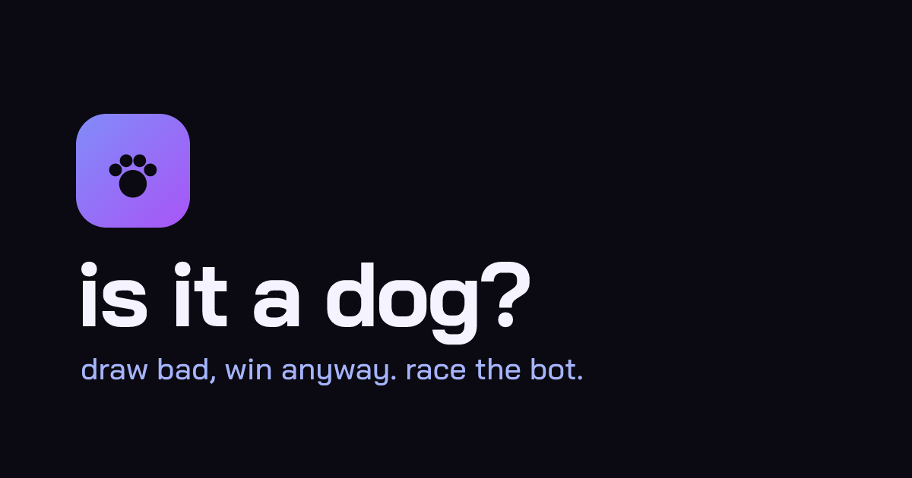

# iguess

Draw badly. Guess wildly.

A multiplayer drawing game where an AI can guess, draw, or play against you.
Draw a secret word, race to guess it, and keep the evidence afterward. No account required.

**[Play iguess](https://iguess.aidenjang.com)**



## Play your way

| Mode        | What happens                                                                |
| ----------- | --------------------------------------------------------------------------- |
| Classic     | Humans take turns drawing; everyone else guesses. Needs another person.     |
| AI Guesser  | You draw and the AI guesses alongside the room.                             |
| AI Drawer   | The AI draws and humans guess.                                              |
| Team Battle | Humans and AI alternate drawing; the first correct guess wins for its side. |
| You vs AI   | Trade drawing turns with the AI and compete on points.                      |

Rooms include avatars, ready states, word packs, custom words, adjustable turn
lengths, drawing tools, reactions and scores. Finished drawings can be replayed
or shared. The AI drawer uses curated vector doodles; AI guessing uses a vision
provider when configured. The machine’s confidence is not a guarantee of talent.

## Run locally

Use Node.js 22 and pnpm 9.15.0, matching CI.

```sh
pnpm install --frozen-lockfile
pnpm --filter @iguess/client build
pnpm run dev:server
```

In separate terminals, also from the repository root:

```sh
pnpm run dev:ai
pnpm run dev:client
```

Open the URL printed by Vite (normally `http://127.0.0.1:33100`). The client proxies
room sockets to the local game server. A client build is needed because the game
server’s asset binding points to its output directory.

Local games do not require an AI key. The server’s development command points to
the local mock AI worker. The AI development command uses its binding-free
`wrangler.mock.toml`; optional local secrets have per-Worker `.dev.vars.example` files. Mock guesses exercise the game flow without recognizing
the drawing. If that worker is stopped, AI guessing reports that it is unavailable;
human play and the curated AI drawer still work. Automated tests use the same mock-only configuration with no Workers AI
binding and check its provider before each AI request. Do not point local testing at a paid production provider.

## Development

```sh
pnpm run verify    # types, lint, repository checks, tests and production build
pnpm run test:e2e  # real local Workers, room sockets and browser flows
pnpm audit --audit-level moderate  # runtime and development dependency advisories
```

- [Architecture](ARCHITECTURE.md): client boundaries, game engine, modes and AI flow.
- [Contributing](CONTRIBUTING.md): changes, validation and commit conventions.
- [Repository conventions](CONVENTIONS.md): code and verification requirements.
- [Security reports](SECURITY.md): private reporting and room trust boundaries.
- [Deployment](DEPLOY.md): Cloudflare setup and secrets.
- [Visual evidence](docs/README.md): screenshot provenance and refresh guidance.
- [Repository audit](docs/REPOSITORY-AUDIT.md): architecture, cleanup and recovery verification.
- [Finishing checklist](docs/ui-review/finish/README.md): acceptance evidence and device-testing limits.

Built with React, TypeScript, Canvas, Cloudflare Workers, Durable Objects and raw
WebSockets. CI verifies pull requests; pushes to `main` deploy after checks pass.

CI uploads the verified client build for deployment. The release job downloads that same
workflow artifact and publishes it without rebuilding the client; local deployment still builds first.

## Data and support

Your name is visible to your room. Preferences and lifetime stats are saved in
this browser. Temporary room checkpoints preserve recovery state for up to a day
after inactivity; chat is not stored in those checkpoints. Room-local reconnect credentials
prove seat ownership, and only their digests are retained on the server. In AI guessing modes, drawings
and masked hints may be sent to the configured vision provider; the secret word
is not supplied to the AI guesser. Anonymous product events count game starts
and finishes by mode.

For help or bugs, [open an issue](https://github.com/aiden-jang/iguess/issues) or
[email me@aidenjang.com](mailto:me@aidenjang.com). Do not include credentials or
private drawings in public reports.

## License

Source code is [MIT licensed](LICENSE). Self-hosted Inter and Fredoka retain their
[font licenses](packages/client/public/licenses), included with the public assets.

Aggregate traffic and feature-event coverage, privacy boundaries and queries: [Analytics](docs/ANALYTICS.md).
